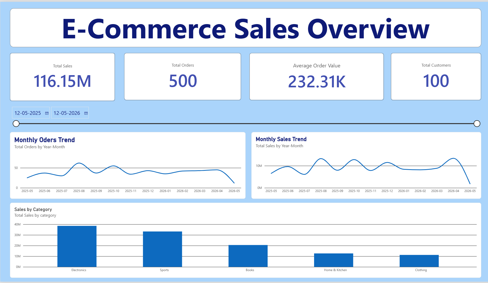
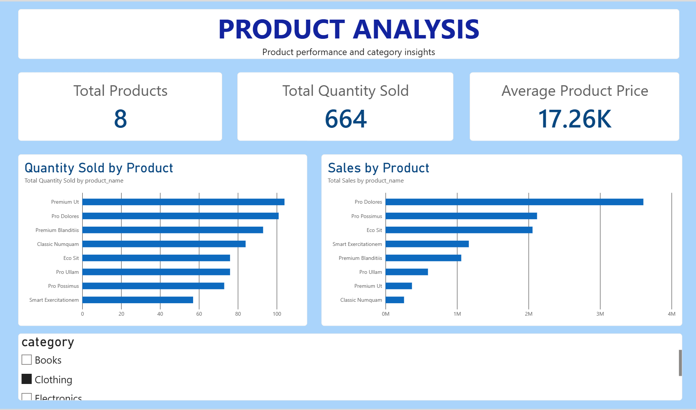
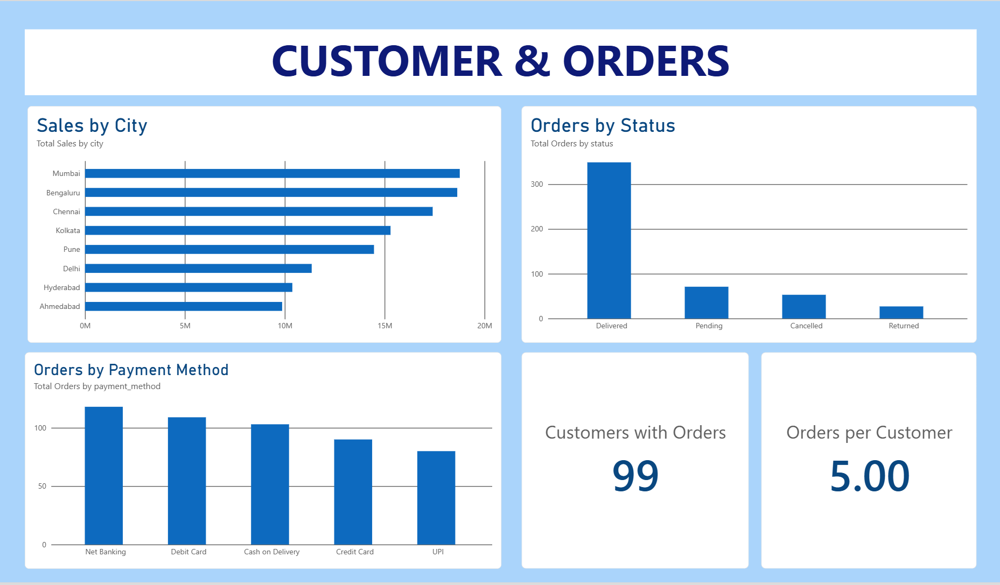

# SalesSphere — Retail Performance Dashboard

## 📌 Project Overview

SalesSphere is an interactive Power BI dashboard developed to analyze e-commerce sales performance, product trends, customer activity, and order patterns.

## 📊 Dashboard Preview

### 1. Sales Overview

### 2. Product Analysis

### 3. Customer & Orders

## 🎯 Business Objectives

- Analyze monthly sales and order trends.
- Identify top-performing products and categories.
- Understand customer activity and city-wise sales.
- Analyze order statuses and payment preferences.
- Support data-driven business decisions.

## 🛠️ Tools & Technologies

- Microsoft Power BI
- Power Query
- DAX
- Data Modeling

## 📈 Key Performance Indicators

- Total Sales
- Total Orders
- Total Customers
- Average Order Value
- Total Quantity Sold
- Total Products
- Customers with Orders
- Orders per Customer

## 💡 Business Insights

- **Sales Trends:** Analyze monthly changes in sales and order volumes.
- **Product Performance:** Compare revenue and quantity sold to understand product performance.
- **Category Performance:** Identify categories contributing the most sales.
- **Geographic Performance:** Compare sales across cities.
- **Order Management:** Examine order status distribution.
- **Payment Preferences:** Identify frequently used payment methods.

## 🎯 Business Recommendations

- Use sales trends to improve inventory and promotional planning.
- Prioritize strong-performing products and investigate weaker performers.
- Optimize marketing strategies based on category performance.
- Investigate lower-performing cities for potential growth opportunities.
- Review unsuccessful order statuses to improve order processing.
- Evaluate payment preferences and investigate payment failures where data is available.

### Sales by Category

- **Top-performing category:** Electronics generates the highest sales, followed by Sports.
- **Revenue concentration:** Electronics and Sports together contribute approximately 62% of the sales shown across the five categories.
- **Growth opportunity:** Clothing and Home & Kitchen generate comparatively lower sales than the leading categories.

### Recommendations

- **Protect leading categories:** Maintain product availability in Electronics and Sports and monitor their sales trends.
- **Investigate lower-performing categories:** Review pricing, product assortment, customer demand, and promotional effectiveness in Clothing and Home & Kitchen.
- **Improve marketing allocation:** Test targeted campaigns for lower-performing categories and measure their impact before increasing spending.
## 🗂️ Data Model

- **Customers:** Customer details and locations.
- **Products:** Product information and categories.
- **Orders:** Order dates, statuses, and payment methods.
- **Order Items:** Product quantities and prices.
- **DateTable:** Calendar information for time-based analysis.

## 📚 Key Learnings

- Data cleaning using Power Query.
- Data modeling and relationships.
- DAX measures and KPI calculations.
- Interactive dashboard development.
- Business-focused data visualization.

## 🚀 Conclusion

SalesSphere demonstrates how Power BI can transform e-commerce data into an interactive business intelligence dashboard for analyzing sales, products, customers, and orders.

## 👤 Author

**Bipin Satyankar**
